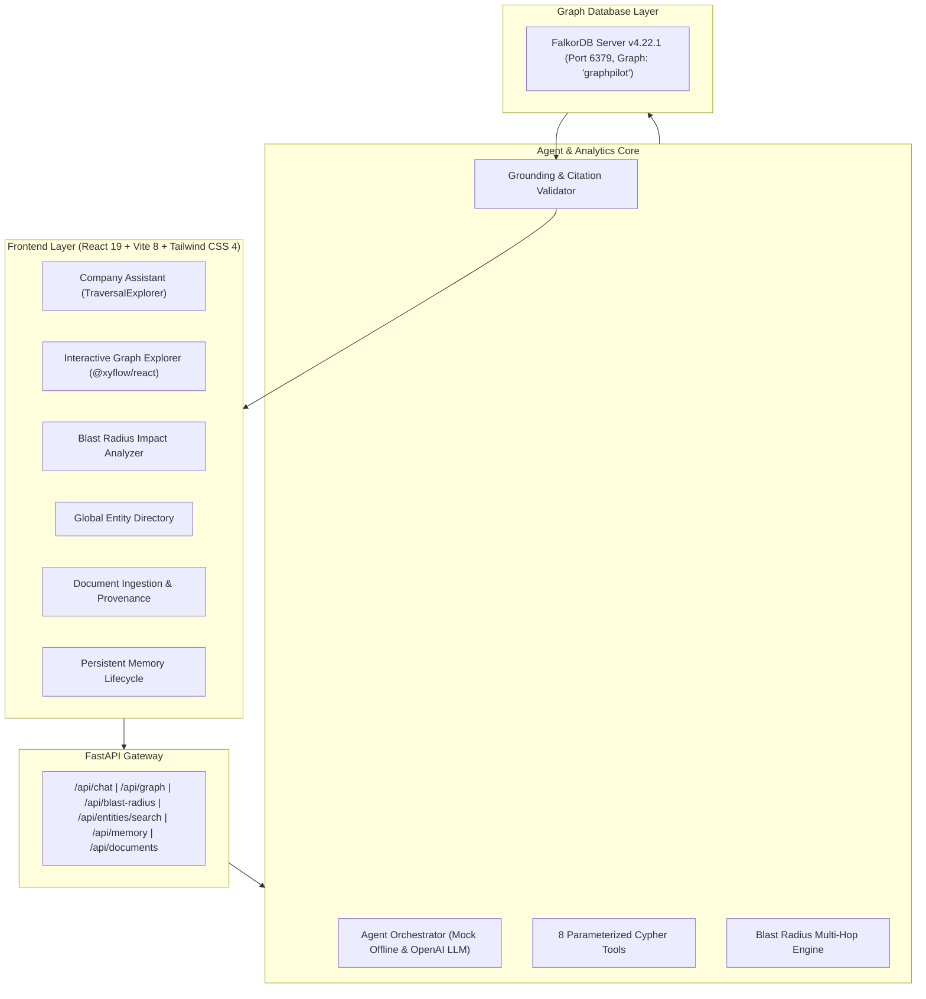

# GraphPilot — Explainable AI Company Brain Powered by FalkorDB

> **Connect Knowledge. Trace Every Relationship. Explain Every Answer.**  
> *Built for Graph Hacks: Context for AI Agents (Track 03 — Company Brain)*

[]()
[]()
[]()
[]()
[]()
[]()

---

## 🔗 Project Links

- **Live Demo:** https://graphpilot-pi.vercel.app/
- **Demo Video:** https://youtu.be/Wuc9eSvyc0E
- **GitHub Repository:** https://github.com/sarveshm555/GraphPilot

---

## 🚀 Overview

**GraphPilot** is an explainable enterprise AI knowledge assistant that uses **FalkorDB** as its primary graph context layer. Unlike traditional vector RAG systems that rely on fuzzy text similarity, GraphPilot traverses explicit organizational relationships across:

- **People** (Engineers, Architects, Product Managers)
- **Teams** (Payments Engineering, Platform Infrastructure, Checkout)
- **Projects** (Project Alpha, Checkout Modernization V2, Project Beta)
- **Systems & Microservices** (Payment API, Transaction Database, Fraud Engine, Notification Service)
- **Documents & Postmortems** (INC-101 resolution report, Architecture blueprints)
- **Incidents** (SEV-1 outages, root causes, resolvers)
- **Decisions** (Architecture Decision Records / ADRs)
- **Support Tickets** (Customer escalations, production alerts)
- **Verified Findings & Memory** (Persistent cross-session knowledge)

---

## 🧠 Why FalkorDB?

When responding to critical organizational questions:
> *"Our payment service is failing. Which projects depend on it? What is the transitive blast radius? Have we experienced a similar incident before? Who handled it? What was the documented resolution?"*

Traditional vector search retrieves isolated text fragments without directional dependencies. **GraphPilot uses FalkorDB to execute parameterized multi-hop Cypher traversals**:
`Project Alpha` ➔ `USES` ➔ `Payment API` ➔ `DEPENDS_ON` ➔ `Transaction Database` ➔ `OWNS` ➔ `Payments Engineering` ➔ `MEMBER_OF` ➔ `Priya Sharma`.

The application returns the **exact graph path**, supporting documents, failure blast radius, and keeps **AI recommendations strictly separated from historical facts**.

---

## ✨ Key Features & Upgrades

### 1. Interactive Knowledge Graph Explorer (`@xyflow/react`)
- Full-screen interactive node-link visualization with custom color-coded badges for all 9 entity labels.
- Zoom, pan, minimap, label filters, and real-time node search.
- Slide-out **Entity Inspector Drawer** displaying properties, incoming/outgoing relationship edges, and connected neighbors.
- One-click jump to Blast Radius Analysis for any system node.

### 2. Blast Radius & Failure Impact Analyzer
- Deep multi-hop Cypher analysis (`/api/blast-radius`) evaluating direct downstream projects, direct upstream dependencies, transitive project impacts, owning teams, on-call engineers, and historical incident precedents.
- Automated severity calculation (`CRITICAL`, `HIGH`, `MEDIUM`, `LOW`) based on service tier and P0 customer projects.
- Depth slider (1 to 5 hops) for dynamic organizational impact exploration.

### 3. Global Entity Directory & Search
- Instant directory across all graph nodes with live connection degree counts.
- Search by name, ID, or description with label filtering.

### 4. Traversal Explorer Component
- Visual step-by-step path stepper embedded in assistant responses.
- Honest separation of historical facts from AI recommendations and graph boundary limitations.

### 5. Persistent Company Memory Lifecycle
- Three-state lifecycle: `proposed` ➔ `verified` ➔ `superseded`.
- Findings survive session restarts and are persisted in FalkorDB.
- In-place supersession creates explicit `:SUPERSEDED_BY` relationships connecting historical findings to current knowledge.

### 6. Document Ingestion with SHA-256 Deduplication
- Ingest Markdown, TXT, or CSV files.
- SHA-256 content hashing detects duplicate files, alerts the user, and prevents redundant graph mutations.

---

## 🛠️ System Architecture



---

## ⚡ Quick Start on Windows 11

### 1. Start FalkorDB in Docker
```powershell
docker run -d --name graphpilot-falkordb -p 6379:6379 -p 3000:3000 falkordb/falkordb:latest
```

### 2. Start Backend API
```powershell
cd c:\Users\sarvesh\OneDrive\Desktop\GRAPHPILOT
.\venv\Scripts\Activate.ps1
uvicorn backend.app.main:app --host 0.0.0.0 --port 8000 --reload
```
- API Docs: `http://localhost:8000/docs`
- Health: `http://localhost:8000/health`

### 3. Start Frontend UI
```powershell
cd c:\Users\sarvesh\OneDrive\Desktop\GRAPHPILOT\frontend
npm run dev
```
- Web Application: `http://localhost:5173`
- FalkorDB Browser: `http://localhost:3000`

---

## ☁️ Cloud Backend Deployment

This section details the production cloud deployment architecture for hosting GraphPilot with a **Vercel frontend**, a **Render FastAPI backend**, and a **FalkorDB Cloud** managed graph database.

> [!NOTE]
> The FalkorDB Cloud instance is currently being provisioned. Follow the setup instructions below to complete remote database connectivity once the instance status is Active.

### 1. Deployment Architecture

```text
User Browser
     |
     v
Vercel Frontend
     |
     | HTTPS API Requests
     v
Render FastAPI Backend
     |
     | Graph Database Connection
     v
FalkorDB Cloud
```

- **Vercel Frontend (`https://graphpilot-pi.vercel.app/`)**: Delivers the compiled React 19 / Vite single-page application and interactive React Flow graph visualization.
- **Render Backend**: Runs the Python 3 FastAPI application with Uvicorn ASGI server in the Singapore region, handling Cypher tool execution and AI orchestration.
- **FalkorDB Cloud**: Managed graph database holding the organizational nodes, relationships, and persistent memory across people, teams, systems, incidents, and decisions.

---

### 2. FalkorDB Cloud Setup

To connect GraphPilot to a remote FalkorDB instance:

1. **Sign Up / Log In**: Access the [FalkorDB Cloud Console](https://app.falkordb.cloud/).
2. **Create Database**: Click **Create Database** and select the **Free Tier** subscription.
3. **Select Region**: Choose a region geographically close to your backend (e.g., Singapore / AWS Asia Pacific).
4. **Provisioning State**: Monitor the database status in the FalkorDB dashboard. Wait until the state transitions from **Provisioning / Creating** to **Active / Ready** before initiating backend connections.
5. **Obtain Connection Details**:
   - **Host / Endpoint**: The remote server address (e.g., FQDN or IP address provided in the dashboard).
   - **Port**: The TCP port (default: `6379`).
   - **Password**: The authentication token or password generated for the database.
   - **TLS / SSL**: Verify if TLS encryption is required by the cloud provider configuration.
6. **Credential Privacy**: Never commit FalkorDB credentials to git or public repositories. Store them strictly in Render's environment variables.

---

### 3. Render Backend Deployment

Configure the FastAPI backend on Render using the following verified repository parameters:

- **Service Type**: Web Service
- **Repository**: `sarveshm555/GraphPilot`
- **Branch**: `main`
- **Runtime**: `Python 3`
- **Region**: `Singapore`
- **Instance Plan**: `Free`
- **Root Directory**: *(Leave empty to use repository root)*
- **Build Command**:
  ```bash
  pip install -r backend/requirements.txt
  ```
- **Start Command**:
  ```bash
  uvicorn app.main:app --app-dir backend --host 0.0.0.0 --port $PORT
  ```
- **Health Check Path**: `/health`

> [!IMPORTANT]
> The `$PORT` environment variable is dynamically allocated by Render. The `--port $PORT` flag ensures Uvicorn binds to Render's assigned port.

---

### 4. Environment Variables

Configure the following environment variables in the Render Dashboard (**Web Service -> Environment -> Environment Variables**):

| Variable Name | Required / Optional | Purpose | Where to Obtain Value |
| :--- | :--- | :--- | :--- |
| `APP_ENV` | Optional | Defines application execution mode (`production` or `development`) | Set to `production` on Render |
| `CORS_ORIGINS` | Required for Cloud | JSON array of allowed origins for cross-origin browser requests | Set to `["https://graphpilot-pi.vercel.app","http://localhost:5173"]` |
| `FALKORDB_HOST` | Required for Cloud | Hostname or FQDN of the remote FalkorDB server | FalkorDB Cloud Dashboard -> Instance Details -> Endpoint |
| `FALKORDB_PORT` | Optional (default: `6379`) | TCP port on which FalkorDB accepts connections | FalkorDB Cloud Dashboard -> Instance Details -> Port |
| `FALKORDB_PASSWORD` | Required for Cloud | Authentication password for remote FalkorDB instance | FalkorDB Cloud Dashboard -> Security / Credentials |
| `FALKORDB_GRAPH_NAME` | Optional (default: `graphpilot`) | Target graph workspace name queried and seeded by the app | Choose a custom name or keep `graphpilot` |
| `LLM_PROVIDER` | Optional (default: `mock`) | AI reasoning mode: `mock` (deterministic zero-key offline) or `openai` (live LLM) | Set to `openai` for live model or `mock` for deterministic demo |
| `OPENAI_API_KEY` | Required if `LLM_PROVIDER=openai` | Secret API key for OpenAI model invocation and tool calling | OpenAI Developer Platform (`platform.openai.com/api-keys`) |
| `OPENAI_MODEL` | Optional (default: `gpt-4o-mini`) | OpenAI model identifier used for bounded tool calling | OpenAI Model Documentation (e.g., `gpt-4o-mini`) |
| `OPENAI_TIMEOUT_SECONDS` | Optional (default: `30.0`) | Client timeout limit in seconds for OpenAI API requests | Configurable integer or float (e.g., `30.0`) |
| `DOCUMENT_STORAGE_PATH` | Optional (default: `./data/documents`) | Container directory for uploaded postmortem and ADR files | Default container storage path |
| `LOG_LEVEL` | Optional (default: `INFO`) | Logging verbosity (`INFO`, `DEBUG`, `WARNING`, `ERROR`) | Set to `INFO` for standard production logs |

---

### 5. Vercel Frontend Connectivity

The frontend API client in [`frontend/src/services/api.ts`](frontend/src/services/api.ts) currently dispatches requests to relative root paths (`/api/...`). To connect the Vercel-hosted frontend to the Render backend, choose one of two supported approaches:

#### Approach A: Vercel Edge Rewrites (Recommended — Zero Code Changes)
Add a `vercel.json` file in the `frontend/` directory (or repository root) to transparently proxy requests to Render:

```json
{
  "rewrites": [
    {
      "source": "/api/:path*",
      "destination": "https://<your-render-service>.onrender.com/api/:path*"
    },
    {
      "source": "/health",
      "destination": "https://<your-render-service>.onrender.com/health"
    }
  ]
}
```
*Benefits*: Eliminates cross-origin preflight requests, preserves relative URLs in code, and avoids browser CORS errors.

#### Approach B: Client Environment Variable
1. In the Vercel Project Dashboard (**Settings -> Environment Variables**), set:
   ```bash
   VITE_API_BASE_URL=https://<your-render-service>.onrender.com
   ```
2. Update [`frontend/src/services/api.ts`](frontend/src/services/api.ts) to resolve:
   ```typescript
   const API_BASE = (import.meta.env.VITE_API_BASE_URL || '').replace(/\/+$/, '') + '/api';
   ```
3. Trigger a redeployment in Vercel (**Deployments -> Redeploy**) after saving variables.

#### CORS Requirement on Backend
Ensure the Render backend has `CORS_ORIGINS` configured to include the Vercel domain:
```bash
CORS_ORIGINS=["https://graphpilot-pi.vercel.app","http://localhost:5173"]
```

---

### 6. Deployment Verification Checklist

Verify each layer of the cloud deployment systematically:

- [ ] **Render Build & Start**: Check Render deployment logs to confirm successful package installation and message: `Application startup complete`.
- [ ] **Health Endpoint**: Send a GET request to `https://<your-render-service>.onrender.com/health`. Verify the returned JSON confirms:
  ```json
  {
    "status": "healthy",
    "service": "GraphPilot Company Brain API",
    "version": "1.0.0",
    "database": {
      "status": "healthy",
      "indicator": "connected",
      "backend": "falkordb-server",
      "connected_to_remote": true
    }
  }
  ```
- [ ] **Graph Overview**: Send a GET request to `https://<your-render-service>.onrender.com/api/overview` to verify `total_nodes` and `total_relationships` reflect the seeded graph.
- [ ] **Multi-Hop Cypher Traversal**: Query `https://<your-render-service>.onrender.com/api/graph/path?start=Project%20Alpha&end=Priya%20Sharma` to verify real-time path discovery.
- [ ] **Diagnostic LLM Connectivity**: Send a POST request to `https://<your-render-service>.onrender.com/api/llm/test` to verify provider status (`llm_active` or `mock_offline`).
- [ ] **Vercel Frontend Communication**: Open `https://graphpilot-pi.vercel.app/` in your browser. Verify the header displays `FalkorDB` with a green indicator dot and active node count.
- [ ] **AI Assistant Q&A**: Submit the question *"Which systems depend on the Payment API?"* in the Command Center to confirm end-to-end question answering and graph path highlighting.

---

### 7. Troubleshooting

| Symptom | Probable Cause | Recommended Action |
| :--- | :--- | :--- |
| **Backend Build Fails on Render** | Missing dependency or Python mismatch | Check Render build logs. Ensure Python 3 runtime is selected and `pip install -r backend/requirements.txt` succeeds. |
| **Database shows `fallback_active`** | FalkorDB Cloud is still provisioning or credentials invalid | Verify instance status in FalkorDB Cloud dashboard is **Active**. Double-check `FALKORDB_HOST`, `FALKORDB_PORT`, and `FALKORDB_PASSWORD` in Render environment settings. |
| **Browser Console: CORS Error** | `CORS_ORIGINS` missing Vercel URL | Ensure `CORS_ORIGINS` on Render is valid JSON containing `"https://graphpilot-pi.vercel.app"`. Restart the Web Service after editing. |
| **Frontend API calls return 404** | Missing Vercel rewrite or incorrect API base | Ensure `vercel.json` rewrites or `VITE_API_BASE_URL` points to the exact Render service URL (`https://<service>.onrender.com`). |
| **Slow Initial Request (30-50s)** | Render Free-Tier instance cold start | Render free instances spin down after 15 minutes of inactivity. Allow up to 50 seconds for the initial wake-up request. |
| **AI Assistant Reports Key Missing** | `LLM_PROVIDER=openai` without valid key | Set `OPENAI_API_KEY` in Render environment settings, or set `LLM_PROVIDER=mock` to switch to deterministic offline demo mode. |

To inspect live backend logs without exposing secrets, use the **Logs** tab in the Render Dashboard.

---

### 8. Security and Free-Tier Limitations

- **Secret Isolation**: Never commit `.env` or production credentials to GitHub. Render securely encrypts environment variables at rest.
- **Frontend Bundle Hygiene**: The Vercel frontend requires zero database passwords or OpenAI API keys; all sensitive graph operations remain strictly on the backend.
- **Render Free Tier**:
  - Instances enter sleep mode after 15 minutes of HTTP inactivity.
  - 512 MB RAM limit and shared CPU.
  - Monthly outbound bandwidth allowance.
- **FalkorDB Cloud Free Tier**:
  - Review memory and storage quotas in your FalkorDB Cloud plan.
  - Note single-zone topology and backup schedules applicable to the free subscription.
- **Production Readiness**: For high-availability enterprise environments, upgrade to persistent paid tiers on both Render and FalkorDB Cloud to eliminate cold starts and resource throttles.

---

## 🧪 Automated Testing (31 of 31 Passed)

GraphPilot includes 31 automated tests covering LLM tool calling, parameter validation, health, schema, multi-hop traversals, unknown entity refusal, blast radius analysis, entity directory search, memory lifecycle, and duplicate document ingestion:

```powershell
.\venv\Scripts\python -m pytest backend/tests -v
```

```text
============================= test session starts =============================
platform win32 -- Python 3.12.4, pytest-9.1.1, pluggy-1.7.0
rootdir: C:\Users\sarvesh\OneDrive\Desktop\GRAPHPILOT
configfile: pytest.ini

backend/tests/test_agent_llm.py::test_mock_offline_mode PASSED           [  3%]
backend/tests/test_agent_llm.py::test_missing_api_key_when_real_provider_selected PASSED [  6%]
backend/tests/test_agent_llm.py::test_genuine_llm_tool_calling_with_mocked_provider PASSED [  9%]
backend/tests/test_agent_llm.py::test_valid_tool_execution_against_falkordb PASSED [ 12%]
backend/tests/test_agent_llm.py::test_invalid_tool_names_and_arguments PASSED [ 16%]
backend/tests/test_agent_llm.py::test_unrelated_cafeteria_question_refusal PASSED [ 19%]
backend/tests/test_agent_llm.py::test_unknown_project_omega_refusal PASSED [ 22%]
backend/tests/test_agent_llm.py::test_unknown_quantum_ledger_refusal PASSED [ 25%]
backend/tests/test_agent_llm.py::test_multi_hop_path_alpha_to_priya PASSED [ 29%]
backend/tests/test_agent_llm.py::test_source_evidence_and_path_validation PASSED [ 32%]
backend/tests/test_agent_llm.py::test_provider_timeouts_and_malformed_responses PASSED [ 35%]
backend/tests/test_agent_llm.py::test_prevention_of_unsupported_claims PASSED [ 38%]
backend/tests/test_core.py::test_health_endpoint PASSED                  [ 41%]
backend/tests/test_core.py::test_overview_endpoint PASSED                [ 45%]
backend/tests/test_core.py::test_tool_find_system_dependencies PASSED    [ 48%]
backend/tests/test_core.py::test_tool_find_previous_incidents PASSED     [ 51%]
backend/tests/test_core.py::test_multi_hop_shortest_path PASSED          [ 54%]
backend/tests/test_core.py::test_agent_refuses_unknown_entity PASSED     [ 58%]
backend/tests/test_core.py::test_agent_chat_multi_hop_answer PASSED      [ 61%]
backend/tests/test_core.py::test_persistent_memory PASSED                [ 64%]
backend/tests/test_core.py::test_document_ingestion_and_provenance PASSED [ 67%]
backend/tests/test_falkordb_real.py::TestRealFalkorDBIntegration::test_real_server_ping PASSED [ 70%]
backend/tests/test_falkordb_real.py::TestRealFalkorDBIntegration::test_real_server_seeding_and_counts PASSED [ 74%]
backend/tests/test_falkordb_real.py::TestRealFalkorDBIntegration::test_real_server_system_dependencies PASSED [ 77%]
backend/tests/test_falkordb_real.py::TestRealFalkorDBIntegration::test_real_server_incident_retrieval PASSED [ 80%]
backend/tests/test_falkordb_real.py::TestRealFalkorDBIntegration::test_real_server_multi_hop_shortest_path PASSED [ 83%]
backend/tests/test_new_features.py::test_blast_radius_payment_api PASSED [ 87%]
backend/tests/test_new_features.py::test_blast_radius_nonexistent_system PASSED [ 90%]
backend/tests/test_new_features.py::test_entities_search PASSED          [ 93%]
backend/tests/test_new_features.py::test_memory_verify_and_supersede PASSED [ 96%]
backend/tests/test_new_features.py::test_document_ingestion_duplicate PASSED [100%]

============================= 31 passed in 22.03s =============================
```

---

## 🎬 3-Minute Hackathon Demo Script

For a detailed step-by-step walkthrough, refer to [docs/demo-script.md](docs/demo-script.md).

1. **Live FalkorDB Status**: Verify live TCP connection (`22+ nodes`, `28+ relationships`).
2. **Multi-Hop Traversal**: Ask *"How is Project Alpha connected to Engineer Priya?"* to inspect the 4-hop chain.
3. **Interactive Graph Explorer**: Pan, zoom, filter by entity type, and inspect neighbors.
4. **Blast Radius Analysis**: Simulate a Payment API failure, revealing downstream customer projects and on-call engineers.
5. **Anti-Hallucination Boundary**: Ask about *"Project Omega"* and observe the honest refusal without hallucinations.
6. **Persistent Memory**: Propose, verify, and supersede findings with `:SUPERSEDED_BY` relationships.
7. **Document Deduplication**: Upload a duplicate postmortem to observe SHA-256 hash matching and zero graph mutation.

---

## 📚 Documentation
- [System Architecture](docs/architecture.md)
- [FalkorDB Graph Schema](docs/graph-schema.md)
- [Deployment Guide](docs/deployment.md)
- [3-Minute Hackathon Demo Script](docs/demo-script.md)
- [Technical Blog Post Draft](docs/blog-draft.md)
- [Verification Checklist](CHECKLIST.md)
