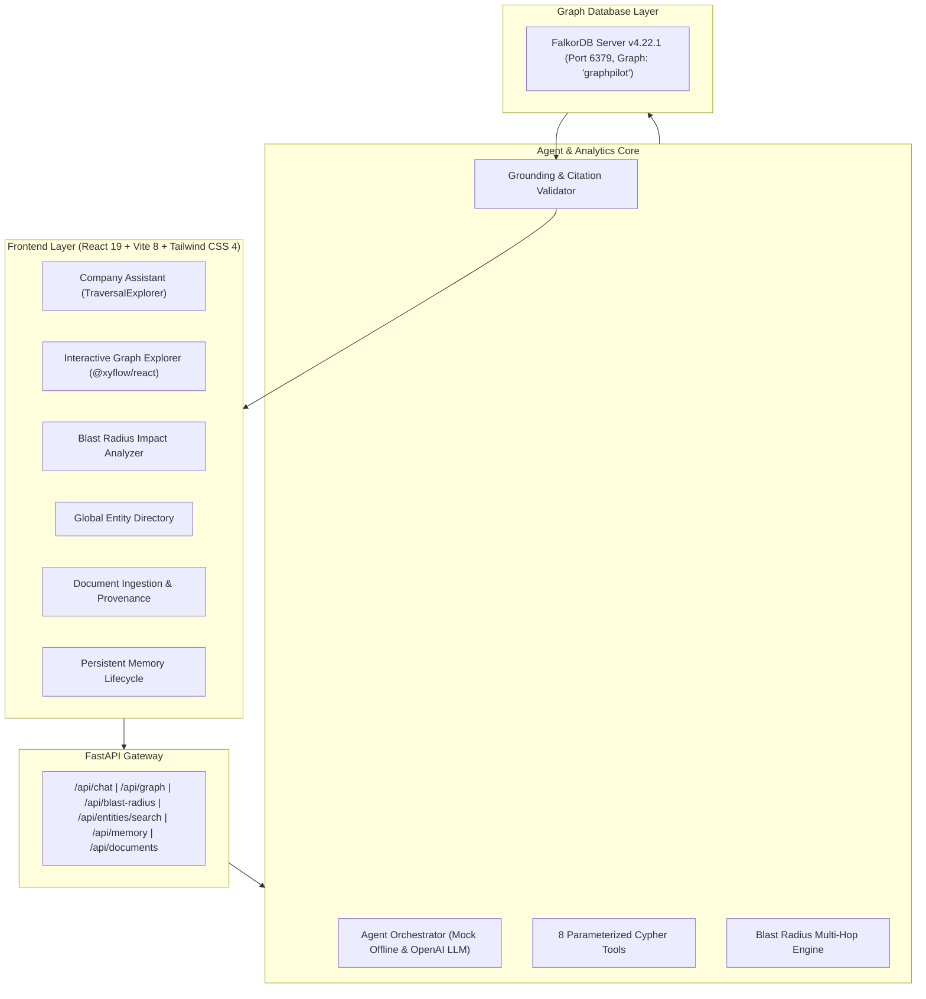

# GraphPilot — Explainable AI Company Brain Powered by FalkorDB

> **Connect Knowledge. Trace Every Relationship. Explain Every Answer.**  
> *Built for Graph Hacks: Context for AI Agents (Track 03 — Company Brain)*

[]()
[]()
[]()
[]()
[]()
[]()

---

## 🚀 Overview

**GraphPilot** is an explainable enterprise AI knowledge assistant that uses **FalkorDB** as its primary graph context layer. Unlike traditional vector RAG systems that rely on fuzzy text similarity, GraphPilot traverses explicit organizational relationships across:

- **People** (Engineers, Architects, Product Managers)
- **Teams** (Payments Engineering, Platform Infrastructure, Checkout)
- **Projects** (Project Alpha, Checkout Modernization V2, Project Beta)
- **Systems & Microservices** (Payment API, Transaction Database, Fraud Engine, Notification Service)
- **Documents & Postmortems** (INC-101 resolution report, Architecture blueprints)
- **Incidents** (SEV-1 outages, root causes, resolvers)
- **Decisions** (Architecture Decision Records / ADRs)
- **Support Tickets** (Customer escalations, production alerts)
- **Verified Findings & Memory** (Persistent cross-session knowledge)

---

## 🧠 Why FalkorDB?

When responding to critical organizational questions:
> *"Our payment service is failing. Which projects depend on it? What is the transitive blast radius? Have we experienced a similar incident before? Who handled it? What was the documented resolution?"*

Traditional vector search retrieves isolated text fragments without directional dependencies. **GraphPilot uses FalkorDB to execute parameterized multi-hop Cypher traversals**:
`Project Alpha` ➔ `USES` ➔ `Payment API` ➔ `DEPENDS_ON` ➔ `Transaction Database` ➔ `OWNS` ➔ `Payments Engineering` ➔ `MEMBER_OF` ➔ `Priya Sharma`.

The application returns the **exact graph path**, supporting documents, failure blast radius, and keeps **AI recommendations strictly separated from historical facts**.

---

## ✨ Key Features & Upgrades

### 1. Interactive Knowledge Graph Explorer (`@xyflow/react`)
- Full-screen interactive node-link visualization with custom color-coded badges for all 9 entity labels.
- Zoom, pan, minimap, label filters, and real-time node search.
- Slide-out **Entity Inspector Drawer** displaying properties, incoming/outgoing relationship edges, and connected neighbors.
- One-click jump to Blast Radius Analysis for any system node.

### 2. Blast Radius & Failure Impact Analyzer
- Deep multi-hop Cypher analysis (`/api/blast-radius`) evaluating direct downstream projects, direct upstream dependencies, transitive project impacts, owning teams, on-call engineers, and historical incident precedents.
- Automated severity calculation (`CRITICAL`, `HIGH`, `MEDIUM`, `LOW`) based on service tier and P0 customer projects.
- Depth slider (1 to 5 hops) for dynamic organizational impact exploration.

### 3. Global Entity Directory & Search
- Instant directory across all graph nodes with live connection degree counts.
- Search by name, ID, or description with label filtering.

### 4. Traversal Explorer Component
- Visual step-by-step path stepper embedded in assistant responses.
- Honest separation of historical facts from AI recommendations and graph boundary limitations.

### 5. Persistent Company Memory Lifecycle
- Three-state lifecycle: `proposed` ➔ `verified` ➔ `superseded`.
- Findings survive session restarts and are persisted in FalkorDB.
- In-place supersession creates explicit `:SUPERSEDED_BY` relationships connecting historical findings to current knowledge.

### 6. Document Ingestion with SHA-256 Deduplication
- Ingest Markdown, TXT, or CSV files.
- SHA-256 content hashing detects duplicate files, alerts the user, and prevents redundant graph mutations.

---

## 🛠️ System Architecture



---

## ⚡ Quick Start on Windows 11

### 1. Start FalkorDB in Docker
```powershell
docker run -d --name graphpilot-falkordb -p 6379:6379 -p 3000:3000 falkordb/falkordb:latest
```

### 2. Start Backend API
```powershell
cd c:\Users\sarvesh\OneDrive\Desktop\GRAPHPILOT
.\venv\Scripts\Activate.ps1
uvicorn backend.app.main:app --host 0.0.0.0 --port 8000 --reload
```
- API Docs: `http://localhost:8000/docs`
- Health: `http://localhost:8000/health`

### 3. Start Frontend UI
```powershell
cd c:\Users\sarvesh\OneDrive\Desktop\GRAPHPILOT\frontend
npm run dev
```
- Web Application: `http://localhost:5173`
- FalkorDB Browser: `http://localhost:3000`

---

## 🧪 Automated Testing (31 of 31 Passed)

GraphPilot includes 31 automated tests covering LLM tool calling, parameter validation, health, schema, multi-hop traversals, unknown entity refusal, blast radius analysis, entity directory search, memory lifecycle, and duplicate document ingestion:

```powershell
.\venv\Scripts\python -m pytest backend/tests -v
```

```text
============================= test session starts =============================
platform win32 -- Python 3.12.4, pytest-9.1.1, pluggy-1.7.0
rootdir: C:\Users\sarvesh\OneDrive\Desktop\GRAPHPILOT
configfile: pytest.ini

backend/tests/test_agent_llm.py::test_mock_offline_mode PASSED           [  3%]
backend/tests/test_agent_llm.py::test_missing_api_key_when_real_provider_selected PASSED [  6%]
backend/tests/test_agent_llm.py::test_genuine_llm_tool_calling_with_mocked_provider PASSED [  9%]
backend/tests/test_agent_llm.py::test_valid_tool_execution_against_falkordb PASSED [ 12%]
backend/tests/test_agent_llm.py::test_invalid_tool_names_and_arguments PASSED [ 16%]
backend/tests/test_agent_llm.py::test_unrelated_cafeteria_question_refusal PASSED [ 19%]
backend/tests/test_agent_llm.py::test_unknown_project_omega_refusal PASSED [ 22%]
backend/tests/test_agent_llm.py::test_unknown_quantum_ledger_refusal PASSED [ 25%]
backend/tests/test_agent_llm.py::test_multi_hop_path_alpha_to_priya PASSED [ 29%]
backend/tests/test_agent_llm.py::test_source_evidence_and_path_validation PASSED [ 32%]
backend/tests/test_agent_llm.py::test_provider_timeouts_and_malformed_responses PASSED [ 35%]
backend/tests/test_agent_llm.py::test_prevention_of_unsupported_claims PASSED [ 38%]
backend/tests/test_core.py::test_health_endpoint PASSED                  [ 41%]
backend/tests/test_core.py::test_overview_endpoint PASSED                [ 45%]
backend/tests/test_core.py::test_tool_find_system_dependencies PASSED    [ 48%]
backend/tests/test_core.py::test_tool_find_previous_incidents PASSED     [ 51%]
backend/tests/test_core.py::test_multi_hop_shortest_path PASSED          [ 54%]
backend/tests/test_core.py::test_agent_refuses_unknown_entity PASSED     [ 58%]
backend/tests/test_core.py::test_agent_chat_multi_hop_answer PASSED      [ 61%]
backend/tests/test_core.py::test_persistent_memory PASSED                [ 64%]
backend/tests/test_core.py::test_document_ingestion_and_provenance PASSED [ 67%]
backend/tests/test_falkordb_real.py::TestRealFalkorDBIntegration::test_real_server_ping PASSED [ 70%]
backend/tests/test_falkordb_real.py::TestRealFalkorDBIntegration::test_real_server_seeding_and_counts PASSED [ 74%]
backend/tests/test_falkordb_real.py::TestRealFalkorDBIntegration::test_real_server_system_dependencies PASSED [ 77%]
backend/tests/test_falkordb_real.py::TestRealFalkorDBIntegration::test_real_server_incident_retrieval PASSED [ 80%]
backend/tests/test_falkordb_real.py::TestRealFalkorDBIntegration::test_real_server_multi_hop_shortest_path PASSED [ 83%]
backend/tests/test_new_features.py::test_blast_radius_payment_api PASSED [ 87%]
backend/tests/test_new_features.py::test_blast_radius_nonexistent_system PASSED [ 90%]
backend/tests/test_new_features.py::test_entities_search PASSED          [ 93%]
backend/tests/test_new_features.py::test_memory_verify_and_supersede PASSED [ 96%]
backend/tests/test_new_features.py::test_document_ingestion_duplicate PASSED [100%]

============================= 31 passed in 22.03s =============================
```

---

## 🎬 3-Minute Hackathon Demo Script

For a detailed step-by-step walkthrough, refer to [docs/demo-script.md](docs/demo-script.md).

1. **Live FalkorDB Status**: Verify live TCP connection (`22+ nodes`, `28+ relationships`).
2. **Multi-Hop Traversal**: Ask *"How is Project Alpha connected to Engineer Priya?"* to inspect the 4-hop chain.
3. **Interactive Graph Explorer**: Pan, zoom, filter by entity type, and inspect neighbors.
4. **Blast Radius Analysis**: Simulate a Payment API failure, revealing downstream customer projects and on-call engineers.
5. **Anti-Hallucination Boundary**: Ask about *"Project Omega"* and observe the honest refusal without hallucinations.
6. **Persistent Memory**: Propose, verify, and supersede findings with `:SUPERSEDED_BY` relationships.
7. **Document Deduplication**: Upload a duplicate postmortem to observe SHA-256 hash matching and zero graph mutation.

---

## 📚 Documentation
- [System Architecture](docs/architecture.md)
- [FalkorDB Graph Schema](docs/graph-schema.md)
- [Deployment Guide](docs/deployment.md)
- [3-Minute Hackathon Demo Script](docs/demo-script.md)
- [Technical Blog Post Draft](docs/blog-draft.md)
- [Verification Checklist](CHECKLIST.md)
