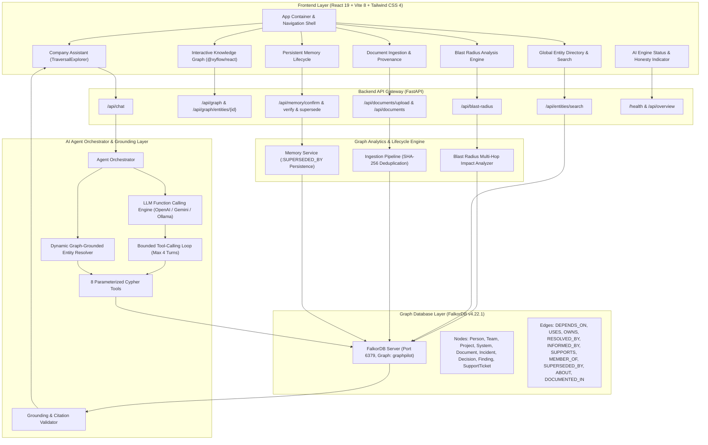

# GraphPilot System Architecture

## Architectural Principles & Guarantees
1. **FalkorDB Graph as Primary Context Layer**: The graph drives multi-hop discovery, reasoning, failure impact analysis, and context extraction.
2. **Deterministic Parameterized Tools**: The LLM or offline resolver selects from 8 predefined tools with validated Pydantic schemas. Arbitrary unvalidated Cypher execution is strictly prevented.
3. **Bounded Multi-Step Tool Calling**: Supports bounded loops (up to 4 turns) allowing multi-step reasoning while preventing unbounded recursion or token waste.
4. **Transparent Configuration & Provider Modes**:
   - `LLM_PROVIDER=mock`: Fully functional offline mode using dynamic entity resolution against FalkorDB without external paid APIs.
   - `LLM_PROVIDER=openai`: Bounded function-calling integration with OpenAI-compatible providers (OpenAI, Gemini, OpenRouter, Ollama).
   - Missing API Key: Explicitly reports configuration error instead of silently pretending an LLM is running.
5. **Strict Grounding & Reality Distinction**: Distinguishes missing knowledge in the graph from absolute non-existence in reality, refuses unknown entities, and isolates AI recommendations from verified historical facts.
6. **Multi-Hop Failure Impact Analysis**: Deep transitive Cypher traversal evaluates downstream projects, direct upstream dependencies, owning teams, on-call engineers, and incident precedents.
7. **Document Deduplication & Idempotent Graph**: SHA-256 content hashing guarantees that identical document uploads will not create duplicate graph nodes or spurious relationships.
8. **Auditable Persistent Memory Lifecycle**: Three-state finding lifecycle (`proposed` -> `verified` -> `superseded`) with explicit `:SUPERSEDED_BY` relationships connecting historical findings to current knowledge.
