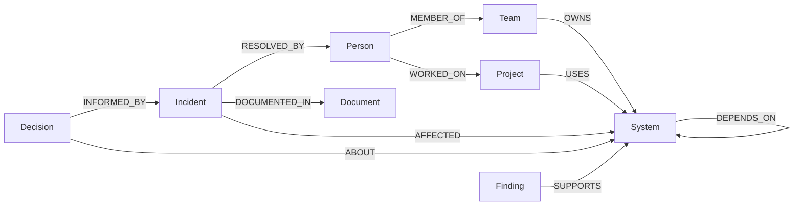

# Building GraphPilot: An Explainable AI Company Brain with FalkorDB
*By Sarvesh | Graph Hacks: Context for AI Agents (Track 03 — Company Brain)*

## 1. Introduction: The Corporate Knowledge Amnesia Problem
Modern technology organizations accumulate immense knowledge across incident postmortems, architecture decision records (ADRs), pull requests, and Jira tickets. Yet when an outage strikes at 2:00 AM, the on-call engineer faces a fragmentation crisis:

> *"Our payment service is throwing 504 timeouts. Which projects depend on it? Has this happened before? Who resolved it, and what document explains the fix?"*

Traditional vector-based Retrieval-Augmented Generation (RAG) fails at this task because text embeddings measure statistical similarity, not explicit relationships. If you ask a vector search about "Payment API dependencies," it may retrieve unrelated text snippets mentioning payment keywords without knowing the actual topological ownership.

Enter **GraphPilot**: an explainable AI company brain powered by **FalkorDB** that connects people, teams, projects, systems, documents, incidents, and decisions into a queryable knowledge graph.

---

## 2. Why Relationships Matter: Beyond Vector Similarity
Knowledge within an organization is intrinsically relational:
- A **Person** is a `MEMBER_OF` a **Team**.
- A **Team** `OWNS` a **System**.
- A **Project** `USES` a **System**.
- A **System** `DEPENDS_ON` another **System**.
- An **Incident** `AFFECTED` a **System**, was `RESOLVED_BY` a **Person**, and was `DOCUMENTED_IN` a **Document**.
- An Architecture **Decision** was `INFORMED_BY` an **Incident**.

By modeling organizational state in **FalkorDB**, we enable true multi-hop reasoning. FalkorDB's Redis-based in-memory graph engine delivers microsecond Cypher query executions, allowing an AI agent to traverse 3 to 5 relationship hops in milliseconds.

---

## 3. The Graph Data Model in FalkorDB
We designed a domain schema tailored for enterprise resilience:



Every node is assigned stable IDs and indexed in FalkorDB using Cypher index definitions:
```cypher
CREATE INDEX FOR (p:Person) ON (p.id);
CREATE INDEX FOR (s:System) ON (s.id);
CREATE INDEX FOR (i:Incident) ON (i.id);
```

---

## 4. Predefined Parameterized Tools: Preventing Cypher Injection & Hallucinations
A common antipattern in "graph AI" applications is passing raw user prompts to an LLM and asking it to write arbitrary Cypher queries. This leads to broken syntax, unpredictable queries, and prompt injection vulnerabilities.

In GraphPilot, we built a strict **catalogue of parameterized tools**:
1. `find_system_dependencies(system_name)`
2. `find_related_projects(system_id)`
3. `find_previous_incidents(system_id)`
4. `find_document_evidence(entity_id)`
5. `trace_decision(target_id)`
6. `recall_company_memory(query)`
7. `shortest_path_between_entities(start, end)`

Every tool enforces typed Pydantic validation, runs parameterized Cypher queries, and returns structured facts and graph paths.

---

## 5. Multi-Hop Graph Reasoning in Action
Consider this complex prompt:
> *"How is Project Alpha connected to Staff Engineer Priya Sharma?"*

GraphPilot executes a multi-hop BFS traversal through FalkorDB:
1. `Project Alpha` -`[:USES]`-> `Payment API`
2. `Payment API` -`[:DEPENDS_ON]`-> `Transaction Database`
3. `Payments Engineering` -`[:OWNS]`-> `Transaction Database`
4. `Priya Sharma` -`[:MEMBER_OF]`-> `Payments Engineering` (and lead on `Project Alpha`)

The agent does not guess this path. The backend returns the concrete traversed edges, and the UI visually highlights the path segments for complete explainability.

---

## 6. Evidence Validation & Fact vs. Recommendation Separation
A core tenet of GraphPilot is honest uncertainty:
- **Graph Facts**: Explicitly returned from FalkorDB nodes and edges.
- **AI Recommendations**: Labeled separately as generative suggestions, never conflated with historical facts.
- **Citation Provenance**: Every cited document includes its ID, title, and excerpt.
- **Entity Refusal**: When asked about a non-existent entity like *"Project Omega"*, GraphPilot refuses to invent details, reporting that the entity was not found in the graph.

---

## 7. Persistent Company Memory
Chat sessions are often ephemeral, losing crucial postmortem resolutions. GraphPilot implements persistent company memory via `:Finding` nodes in FalkorDB:
```cypher
MERGE (f:Finding {id: $id})
SET f.text = $text, f.created_at = $created_at, f.verification_status = 'verified'
WITH f
MATCH (target:System {id: $target_id})
MERGE (f)-[:SUPPORTS]->(target)
```
When an engineer confirms a finding in the dashboard, it is stored in FalkorDB and immediately becomes retrievable in subsequent chat sessions.

---

## 8. Architecture and Cloud Deployment
GraphPilot is designed for high portability and enterprise cloud readiness:
- **Frontend**: React 18, Vite, Tailwind CSS, Lucide icons.
- **Backend**: Python 3.12, FastAPI, Pydantic, FalkorDB official client.
- **Local Dev**: Docker Compose orchestrating FalkorDB, FastAPI, and Nginx.
- **AWS Serverless**: AWS Lambda + API Gateway for API execution, Amazon S3 for documents, with persistent FalkorDB running in a dedicated VPC.

---

## 9. Key Lessons & Conclusion
1. **Graphs Provide Deterministic Grounding**: Graph databases provide structural guarantees that semantic vector search cannot replicate.
2. **Explainability Drives Enterprise Trust**: Displaying explicit graph paths gives engineers confidence that the AI's response is grounded in company truth.
3. **FalkorDB is a Game-Changer for AI Agents**: Its low-latency Cypher execution and compact footprint make it ideal as an agent context layer.

GraphPilot demonstrates that the future of enterprise AI is not bigger LLMs, but smarter, graph-grounded context.
