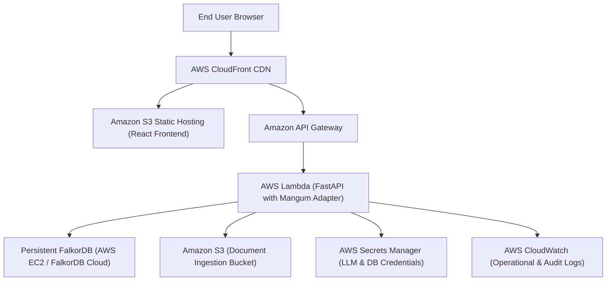

# GraphPilot Deployment Guide

## Local Development (With or Without Docker)

### Option A: Local Python & Vite (Instant dev)
1. **Activate Python environment & install requirements**:
   ```powershell
   python -m venv venv
   .\venv\Scripts\pip install -r backend\requirements.txt
   ```
2. **Start Backend**:
   ```powershell
   $env:PYTHONPATH="backend"
   .\venv\Scripts\uvicorn app.main:app --port 8000 --reload
   ```
3. **Start Frontend**:
   ```powershell
   cd frontend
   npm install
   npm run dev
   ```
4. Access UI at `http://localhost:5173`.

---

### Option B: Docker Compose (Full Stack with FalkorDB Container)
```bash
docker compose up --build
```
This deploys:
- `falkordb`: Port 6379 with persistent volume `falkordb_data`
- `backend`: FastAPI API server on port 8000
- `frontend`: Production Nginx bundle on port 80

---

## AWS Cloud Deployment Architecture



### Serverless Execution Rules
> [!IMPORTANT]
> FalkorDB is an in-memory graph database engine and **must not be run inside AWS Lambda**. 
> Deploy FalkorDB on an Amazon EC2 instance within a private VPC or utilize a managed FalkorDB Cloud cluster. AWS Lambda connects securely via VPC peering / security group rules over port 6379.
