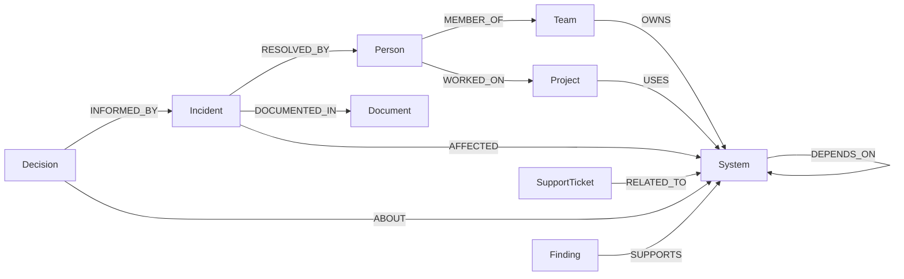

# FalkorDB Knowledge Graph Schema

## Node Labels & Properties

| Label | Properties | Description |
|---|---|---|
| `Person` | `id`, `name`, `role`, `email`, `tenant_id` | Engineers, managers, architects, and technical contributors |
| `Team` | `id`, `name`, `mission`, `tenant_id` | Engineering teams, platform groups, infrastructure units |
| `Project` | `id`, `name`, `status`, `priority`, `tenant_id` | Active or historical company initiatives |
| `System` | `id`, `name`, `description`, `criticality`, `tenant_id` | Software microservices, databases, and message brokers |
| `Document` | `id`, `title`, `source_uri`, `source_type`, `content_hash`, `excerpt` | Postmortems, runbooks, architecture design records |
| `Incident` | `id`, `title`, `summary`, `resolution`, `created_at`, `status` | Outages, degradation incidents, and root cause items |
| `SupportTicket` | `id`, `title`, `priority`, `status`, `tenant_id` | Customer issue reports related to services |
| `Decision` | `id`, `title`, `rationale`, `status`, `created_at` | Architecture Decision Records (ADRs) |
| `Finding` | `id`, `text`, `created_at`, `session_id`, `verification_status` | Confirmed facts and persistent company memory |

## Relationship Types



## Multi-Hop Example
```cypher
MATCH path = (p:Project {id: "proj-alpha"})-[:USES]->(s:System)-[:DEPENDS_ON]->(db:System)<-[:OWNS]-(t:Team)<-[:MEMBER_OF]-(eng:Person)
RETURN path
```
This traversal connects `Project Alpha` to `Priya Sharma` via 4 discrete graph hops without requiring loose text search.
